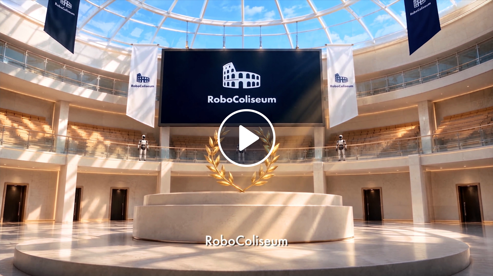

<p align="center">
  
</p>

<h2 align="center">Robotic evaluation,<br>step by step with an AI agent.</h2>

<p align="center">
  A benchmark for robotic policies and agents across instruction following,<br>
  spatial reasoning, robustness, and general manipulation.
</p>

<p align="center">
  <a href="https://sim-challenge-frontend.ks3-cn-beijing.ksyuncs.com/video/robocoliseum/robocoliseum-2.0-1080p-8d59d193b2fb.mp4" title="Start the RoboColiseum overview video">
    
  </a>
</p>

<p align="center">
  
</p>

<p align="center">
  <a href="#quick-start"><strong>🚀 Get started</strong></a> &nbsp;·&nbsp;
  <a href="https://robocoliseum.ai/usage#leader-overview">🎯 Explore the tracks ↗</a> &nbsp;·&nbsp;
  <a href="#skills">🧩 Skills</a> &nbsp;·&nbsp;
  <a href="#resources">📦 Resources</a><br>
  <a href="https://robocoliseum.ai/">🏟️ Platform ↗</a> &nbsp;·&nbsp;
  <a href="https://robocoliseum.ai/leaderboard">🏆 Leaderboard ↗</a> &nbsp;·&nbsp;
  <a href="https://robocoliseum.ai/usage">📖 Usage ↗</a> &nbsp;·&nbsp;
  <a href="#citation">📄 Citations</a>
</p>

Use this repository's skills with your preferred AI assistant to prepare a
model, connect inference, and review task-level results.

---

<a id="quick-start"></a>

## 🚀 Quick start

### 1. Get the repository

```bash
git clone https://github.com/RoboColiseum/RoboColiseum.git
cd RoboColiseum
```

Open this folder in your AI coding assistant. You can use the skills directly
from the checkout; no global skill installation is needed to get started.

### 2. Pick your evaluation path

<table>
  <tr>
    <td width="50%" valign="top">
      <h3>🏟️ Hosted evaluation</h3>
      <p>Evaluate on the platform and compare results.</p>
      <p><strong>RoboColiseum</strong> runs and scores simulation.<br><strong>Your compute</strong> runs model inference.<br>A platform account is required.</p>
      <p><a href="#hosted-evaluation"><strong>Follow the hosted workflow →</strong></a></p>
    </td>
    <td width="50%" valign="top">
      <h3>🖥️ Local benchmark</h3>
      <p>Prepare a simulation environment and debug locally.</p>
      <p><strong>Your compute</strong> runs simulation and inference.<br>Use a separate Genie Sim checkout.<br>No platform account is needed.</p>
      <p><a href="#local-benchmark"><strong>Prepare your local environment →</strong></a></p>
    </td>
  </tr>
</table>

### 3. Start a conversation

```text
Read AGENTS.md and skills/challenge-help/SKILL.md.
Help me get started with RoboColiseum. First determine whether I need
hosted evaluation or a local benchmark environment. Inspect my existing
checkout and model setup, identify what is missing, and explain the next steps.
```

Already know your goal? Use one of the specific prompts below. The assistant
reads the relevant `SKILL.md` and works through its instructions with you.

<a id="hosted-evaluation"></a>

## 🏟️ Run a hosted evaluation

**Your compute runs model inference. RoboColiseum runs and scores simulation.**
Keep your model's inference environment available while following this workflow.

| Step | What you do | Skills |
| --- | --- | --- |
| **01 · 🌱 Prepare** | Choose a track and prepare a baseline or your own model. | [Training data](skills/challenge-download-datasets/SKILL.md) · [Baseline setup](skills/challenge-baseline-model/SKILL.md) |
| **02 · 🔌 Connect** | Sign in and check the observation/action interface. | [Login](skills/challenge-login/SKILL.md) · [Inference protocol](skills/challenge-inference-protocol/SKILL.md) |
| **03 · 🚀 Evaluate** | Create a job and connect your inference service using its returned details. | [Submit a job](skills/challenge-submit-job/SKILL.md) · [Run inference](skills/challenge-run-agent/SKILL.md) |
| **04 · 📊 Review** | Track progress, inspect per-task scores, and compare results. | [Poll results](skills/challenge-poll-result/SKILL.md) · [Rankings](skills/challenge-ranking/SKILL.md) |

### 💬 Pick a prompt for your next step

Choose the goal that matches your work, then copy the prompt into your assistant.

<details>
<summary><strong>🌱 I want to start with a baseline</strong></summary>

```text
Read AGENTS.md. Use challenge-help, challenge-download-datasets, and
challenge-baseline-model to help me prepare a RoboColiseum baseline.
Inspect my environment, help me choose a track, and explain the code,
weights, and training-data needs before starting setup.
```

</details>

<details>
<summary><strong>🧠 I already have a model</strong></summary>

```text
Read AGENTS.md. Use challenge-inference-protocol to inspect my model's
observation and action interface, then challenge-help to plan its hosted
evaluation. Identify integration changes and missing information before
using challenge-submit-job and challenge-run-agent.
```

</details>

<details>
<summary><strong>📊 I want to understand my results</strong></summary>

```text
Read AGENTS.md. Use challenge-poll-result and challenge-ranking to review
my RoboColiseum evaluation. Identify the correct job, check its progress,
and explain the available per-task scores and leaderboard result.
```

</details>

<details>
<summary><strong>🔧 My inference connection needs help</strong></summary>

```text
Read AGENTS.md. Use challenge-troubleshoot and challenge-diagnose-connection
to investigate my RoboColiseum inference connection. Check the actual job
state and available logs, explain the likely cause, and suggest a targeted fix.
```

</details>

For the current manual procedure, account requirements, and scoring rules,
follow the [official usage guide](https://robocoliseum.ai/usage). The skills
check the current submission quota; creating jobs and launching inference
use the approvals described in the selected workflow.

<a id="local-benchmark"></a>

## 🖥️ Prepare a local benchmark

Use [**local-benchmark**](skills/local-benchmark/SKILL.md) to prepare Genie Sim
on your own machine. It inspects the host, reuses or prepares a separate
simulation checkout, obtains task assets, selects a compatible container,
and checks the required runtime and ROS workspace.

The documented container route uses **Linux, an NVIDIA GPU, and Docker**.
The skill reads your simulation checkout's requirements before selecting
versions or downloads. Model inference remains in its own environment.

```text
Read AGENTS.md and skills/local-benchmark/SKILL.md.
Help prepare my local Genie Sim benchmark environment. Reuse my existing
checkout and assets, inspect the host first, and explain the task, runtime,
and download plan. Report host readiness, asset verification, simulator
initialization, and a scored policy run separately.
```

<details>
<summary><strong>🔍 Run the read-only host preflight yourself</strong></summary>

Set `SIM_REPO_ROOT` to your Genie Sim checkout and `SIM_ASSETS` to its asset
directory, then run this command from the RoboColiseum repository:

```bash
python3 skills/local-benchmark/scripts/preflight.py \
  --repo "$SIM_REPO_ROOT" \
  --assets "$SIM_ASSETS"
```

The helper checks Python, NVIDIA visibility, Docker access, disk space, and
checkout/asset paths. It does not install packages, download assets, or
launch a simulator. A nonzero exit code reports prerequisites that need attention.

</details>

Local results do not automatically appear on the hosted leaderboard. Use
the [hosted workflow](#hosted-evaluation) when you want a platform evaluation.

<a id="skills"></a>

## 🧩 A skill for every next step

The toolkit contains **11 website-imported participation skills** and the
RoboColiseum-maintained **local-benchmark** skill, with **4 helper scripts**.
Each skill is a readable `SKILL.md` with a focused workflow.

<details>
<summary><strong>Browse all 12 skills</strong></summary>

| Goal | Skill |
| --- | --- |
| Find the right workflow | [challenge-help](skills/challenge-help/SKILL.md) |
| Prepare Genie Sim locally | [local-benchmark](skills/local-benchmark/SKILL.md) |
| Get training data | [challenge-download-datasets](skills/challenge-download-datasets/SKILL.md) |
| Set up a baseline | [challenge-baseline-model](skills/challenge-baseline-model/SKILL.md) |
| Sign in | [challenge-login](skills/challenge-login/SKILL.md) |
| Understand observations and actions | [challenge-inference-protocol](skills/challenge-inference-protocol/SKILL.md) |
| Create an evaluation | [challenge-submit-job](skills/challenge-submit-job/SKILL.md) |
| Connect model inference | [challenge-run-agent](skills/challenge-run-agent/SKILL.md) |
| Inspect progress and task scores | [challenge-poll-result](skills/challenge-poll-result/SKILL.md) |
| Check leaderboard results | [challenge-ranking](skills/challenge-ranking/SKILL.md) |
| Resolve workflow failures | [challenge-troubleshoot](skills/challenge-troubleshoot/SKILL.md) |
| Diagnose tunnel connections | [challenge-diagnose-connection](skills/challenge-diagnose-connection/SKILL.md) |

</details>

To install them in another assistant, copy the `skills/challenge-*` and
`skills/local-benchmark` folders into that assistant's configured skills
directory. Keep each folder and its `scripts/` together. The
[skill reference](skills/README.md) covers installation and shared state;
[maintenance notes](skills/MAINTENANCE.md) record provenance and local corrections.

<a id="resources"></a>

## 📦 Data, models, and implementation

| Resource | Where to go |
| --- | --- |
| **Training task suites** | [Hugging Face](https://huggingface.co/datasets/agibot-world/GenieSim3.0-Dataset/tree/main/task_suite) · [ModelScope mirror](https://modelscope.cn/datasets/agibot_world/GenieSim3.0-Dataset/tree/master/task_suite) |
| **Baseline checkpoints** | [Hugging Face](https://huggingface.co/datasets/agibot-world/GenieSim3.0-Dataset/tree/main/checkpoints) · [ModelScope mirror](https://modelscope.cn/datasets/agibot_world/GenieSim3.0-Dataset/tree/master/checkpoints) |
| **Baseline setup** | [Baseline skill](skills/challenge-baseline-model/SKILL.md) · [ACoT-VLA](https://github.com/AgibotTech/ACoT-VLA) |
| **Simulation and local benchmark** | [Genie Sim code](https://github.com/AgibotTech/genie_sim) · [Genie Sim project](https://agibot-world.com/genie-sim) |
| **LLM-to-action runtime** | [Agent2Act](https://github.com/AgibotTech/genie_sim/tree/main/source/agent2act) |
| **Tasks, scoring, and results** | [Usage guide](https://robocoliseum.ai/usage) · [Live leaderboard](https://robocoliseum.ai/leaderboard) |

RoboColiseum is the evaluation entry point; Genie Sim provides the supporting
simulation technology. Linked code, datasets, and models retain their own
licenses and terms.

<a id="citation"></a>

## 📄 Research and citation

- [**RoboColiseum cross-model evaluation** — Frontier LLMs Enter the World of Robotics](https://arxiv.org/abs/2610.27865)
- [**Genie Sim 3.0** — A High-Fidelity Comprehensive Simulation Platform for Humanoid Robot](https://arxiv.org/abs/2601.02078)

<details>
<summary><strong>BibTeX · RoboColiseum</strong></summary>

```bibtex
@misc{huang2026frontierllmsenterworld,
  title={Frontier LLMs Enter the World of Robotics: A Cross-Model Evaluation on RoboColiseum},
  author={Da Huang and Jichao Wang and Junhui Wu and Tong Ran and Linting Guo and Siying Zhang and Chuang Men and Sukai Wang and Yue Zhou and Maoqing Yao and Mo Wu},
  year={2026},
  eprint={2610.27865},
  archivePrefix={arXiv},
  primaryClass={cs.RO},
  url={https://arxiv.org/abs/2610.27865}
}
```

</details>

<details>
<summary><strong>BibTeX · Genie Sim 3.0</strong></summary>

```bibtex
@misc{yin2026geniesim30,
  title={Genie Sim 3.0 : A High-Fidelity Comprehensive Simulation Platform for Humanoid Robot},
  author = {Chenghao Yin and Da Huang and Di Yang and Jichao Wang and
            Nanshu Zhao and Chen Xu and Wenjun Sun and Linjie Hou and
            Zhijun Li and Junhui Wu and Zhaobo Liu and Zhen Xiao and
            Sheng Zhang and Lei Bao and Rui Feng and Zhenquan Pang and
            Jiayu Li and Qian Wang and Maoqing Yao},
  year={2026},
  eprint={2601.02078},
  archivePrefix={arXiv},
  primaryClass={cs.RO},
  url={https://arxiv.org/abs/2601.02078},
}
```

</details>

## 🤝 Get help and contribute

For participation and account questions, join the
[community](https://robocoliseum.ai/community) or contact
[support@robocoliseum.ai](mailto:support@robocoliseum.ai). For setup or
inference issues, start with the [troubleshooting skill](skills/challenge-troubleshoot/SKILL.md).

To improve a guide or skill, see [contributing and maintenance](skills/MAINTENANCE.md#contributing).
Agent instructions live in [AGENTS.md](AGENTS.md).

<p align="center"><a href="#quick-start">Back to quick start ↑</a></p>
